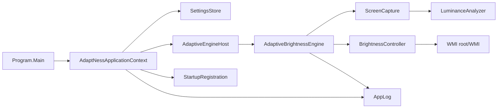

# Architecture

AdaptNess is a .NET 10 Windows Forms `WinExe`. Its UI is an `ApplicationContext` with a notification-area icon rather than a main window. The adaptive worker runs on a background task and communicates with Windows display APIs through two small components.

## Startup and tray lifecycle

`Program.Main` handles `--self-test` first. Otherwise it creates the named `Local\AdaptNess` mutex; a second process shows a message and exits. The first process initializes WinForms and runs `AdaptNessApplicationContext`.

The context loads settings, creates the tray menu and icon, and starts the engine if `AdaptiveEnabled` is true. A left click and the menu's enable item toggle that setting. The pause action stops the engine without changing the saved enabled setting, then a WinForms timer starts it again after 15 minutes. Settings opens one modeless form at a time. Exit stops the timer, closes settings, hides and disposes the tray controls, stops and disposes the engine host, and exits the WinForms message loop.

The engine host guards its worker and cancellation source with a lock. `Start` is idempotent while a task is active. `StopAsync` cancels and awaits that task before clearing the host state. The worker owns and disposes its `BrightnessController` and `ScreenCapture` instances. Expected cancellation is swallowed; other worker exceptions are logged. If a worker returns without cancellation, the host logs that automatic changes have stopped. The tray's enabled label reflects the saved enabled and pause state; it does not report whether the worker is currently healthy.

## Capture and luminance

The host creates `ScreenCapture` with a 32×18 target size. Each sample obtains the primary-screen dimensions using `GetSystemMetrics`, obtains the desktop device context with `GetDC(NULL)`, and uses GDI `StretchBlt` with `SRCCOPY | CAPTUREBLT` to scale the screen into a compatible bitmap. `GetDIBits` returns a top-down 32-bit BGRA byte buffer. GDI objects and device contexts are released in a `finally` block on success and failure.

This keeps capture in a small native buffer and avoids creating a managed full-resolution screenshot. It still samples the desktop image, including visible windows and overlays where Windows permits capture. It does not identify which window produced a pixel, select a display, or guarantee access to protected or secure content. A failed native operation returns no sample; the engine logs the first failure in a run, holds brightness, and retries on later iterations.

`LuminanceAnalyzer` computes the arithmetic mean of each pixel's normalized perceived luminance:

`Y = 0.2126R + 0.7152G + 0.0722B`

The alpha byte is ignored. No image object is retained by the engine after the byte buffer is analyzed.

## Target calculation and brightness updates

The engine samples every 250 ms. It applies an exponential moving average with a 0.7-second time constant using `alpha = 1 - exp(-interval / timeConstant)`. `MapLuminanceToBrightness` clamps luminance to [0, 1], applies the smoothstep curve `x²(3 - 2x)`, inverts it, and maps it into the configured range. An additional 2% margin at the bright end is part of the current mapping. With the default 28–50 range, dark input maps to 50% and white input maps to 28%.

The result is adjusted by a temporary manual-preference offset and clamped to the configured range. `AdaptiveControlState` accepts a new target only when it differs from the stable target by more than four brightness points. This deadband holds small integer changes caused by sample variation.

Brightness writes are separated by at least 650 ms. Each requested value is at most four points from the last requested value, in the direction of the stable target. The engine records a request only when `SetBrightness` succeeds, so subsequent steps converge from the last successful request. These limits and timing values are fixed in the current implementation; they are not settings UI options.

## WMI and manual changes

`BrightnessController` queries `root\WMI` for `WmiMonitorBrightness`. It returns the first result's `CurrentBrightness`. To set a value it queries `WmiMonitorBrightnessMethods`, invokes `WmiSetBrightness` on each returned instance, and clamps the value to the configured range. A completed query with at least one invocation is reported as a successful write. A WMI, COM, or access failure during a write marks the controller unavailable; the engine then stops making changes. WMI read exceptions are logged and return false; a query with no result also returns false. Read failures do not mark the controller unavailable.

Every five seconds the engine polls current brightness. A value within one point of the last request is treated as normal readback. A different readback is ignored while a recent automatic write is within its eight-second settling window. After that, a difference of at least three points can be classified as a manual change; the same observed value is not repeatedly classified. The detected brightness becomes the new request baseline and supplies an offset relative to the current mapped target. The offset is bounded by the configured range span and is held in memory only. It resets when the engine restarts.

## Settings, startup, and logging

`AppSettings` defaults to a 28–50 automatic range, adaptation enabled, and Start with Windows disabled. `Normalize` constrains the range to 1–99 and keeps maximum above minimum. `SettingsStore` reads and writes indented JSON at `%LocalAppData%\AdaptNess\settings.json`. A missing or unreadable/malformed settings file falls back to defaults; load failures are logged. Saving creates the directory and writes the normalized settings.

When settings are saved, `StartupRegistration` updates the current user's `Run` registry value, then settings are saved. The command points to the current executable, or to `AdaptNess.dll` when launched through `dotnet`. Enabling or disabling adaptation stops or starts the worker. Changing the minimum or maximum restarts a running worker so its controllers receive the new bounds.

`AppLog` writes timestamped operational messages to `%LocalAppData%\AdaptNess\adaptNess.log` and also sends them to `Debug.WriteLine`. Before an append, a log larger than 512 KiB is truncated. Log write failures are swallowed to keep diagnostics from interfering with control or shutdown. Exception type and message text may be included. Tray action exceptions are logged and shown as an error balloon. Settings apply failures are logged and shown in a dialog, leaving the settings form open for correction or retry.

## Self-tests

The `--self-test` path runs before mutex creation or UI initialization. The in-process checks cover luminance samples, mapping values, target deadband, stepwise convergence, retargeting, and readback/manual-change classification. A failed assertion throws, is logged, and sets a nonzero process exit code. These checks do not exercise Windows capture, WMI hardware, the tray UI, or registry integration.
